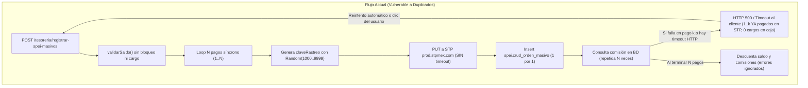
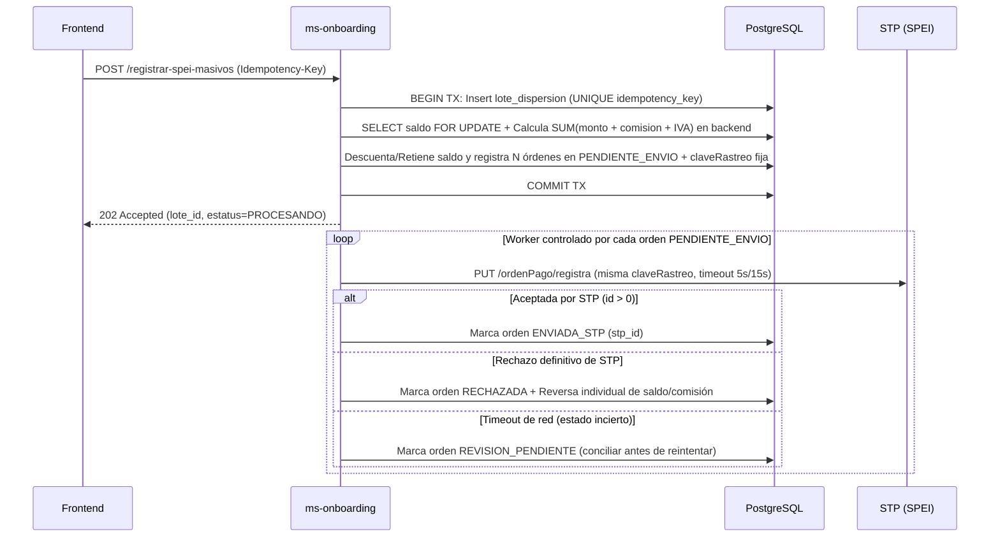

# Auditoría Técnica y Plan de Mejoras — `ms-onboarding`

Fecha de revisión: `2026-10-30`  
Repositorio analizado: `ms-onboarding` (`Spring Boot 2.7.3` / `Java 17` / `PostgreSQL` / `STP SPEI`)

---

## Resumen Ejecutivo

Durante la revisión integral del microservicio se identificaron **fallas críticas de arquitectura transaccional, concurrencia, seguridad y observabilidad**. El hallazgo más urgente es que el flujo de **dispersión masiva de nómina SPEI (`/tesoreria/registrar-spei-masivos`) carece de idempotencia, control de concurrencia, timeouts HTTP, atomicidad contable y trazabilidad en logs**, lo cual explica directamente la **duplicación de pagos reales hacia STP** y la ausencia de errores visibles de dispersión en consola.

Adicionalmente, existen vulnerabilidades críticas de seguridad (secretos productivos en Git, endpoints administrativos/de contraseñas abiertos sin autenticación bajo `/onboarding/**`, contraseñas cifradas de forma reversible con AES e IV estático, y falta de validación de pertenencia de cuenta en operaciones financieras) y un riesgo de **deadlock en el pool de conexiones HikariCP**.

---

## 1. Diagnóstico Profundo: ¿Por qué se duplican las dispersiones masivas?

Archivos involucrados:
- [`ImplPagosMasivosServices.java`](file:///Users/danielloza/Documents/banca/ms-onboarding/src/main/java/com/lksbaas/mx/service/impl/ImplPagosMasivosServices.java)
- [`TesoreriaController.java`](file:///Users/danielloza/Documents/banca/ms-onboarding/src/main/java/com/lksbaas/mx/controller/TesoreriaController.java)
- [`ImplUtilsServices.java`](file:///Users/danielloza/Documents/banca/ms-onboarding/src/main/java/com/lksbaas/mx/service/impl/ImplUtilsServices.java)
- [`ImplSaldoServices.java`](file:///Users/danielloza/Documents/banca/ms-onboarding/src/main/java/com/lksbaas/mx/service/impl/ImplSaldoServices.java)

### Flujo Actual vs. Flujo Bancario Seguro



### Las 5 causas técnicas combinadas

1. **Nula Idempotencia y `claveRastreo` aleatoria en cada petición** ([`ImplPagosMasivosServices.java:113-114`](file:///Users/danielloza/Documents/banca/ms-onboarding/src/main/java/com/lksbaas/mx/service/impl/ImplPagosMasivosServices.java#L113-L114), [`ImplUtilsServices.java:70-84`](file:///Users/danielloza/Documents/banca/ms-onboarding/src/main/java/com/lksbaas/mx/service/impl/ImplUtilsServices.java#L70-L84))
   - STP previene órdenes duplicadas únicamente si recibe la **misma** `claveRastreo` para la misma `empresa` y `fechaOperacion`.
   - El backend ignora cualquier identificador de lote y construye en cada llamada una `claveRastreo` nueva concatenando `new Random().nextInt(9000) + 1000` más un consecutivo leído sin bloqueo (`SELECT ... ORDER BY id DESC LIMIT 1`).
   - Resultado: ante cualquier doble clic, reintento de red o reenvío de nómina, STP recibe claves de rastreo distintas y **liquida nuevamente todos los pagos**.

2. **Procesamiento síncrono secuencial sin Timeouts provoca Timeouts de Red/Proxy y Reintentos** ([`ImplPagosMasivosServices.java:110-270`](file:///Users/danielloza/Documents/banca/ms-onboarding/src/main/java/com/lksbaas/mx/service/impl/ImplPagosMasivosServices.java#L110-L270))
   - Por cada empleado de la nómina se ejecutan en serie: consulta de última clave en BD, lectura de archivo `.pem` desde classpath, llamada HTTPS `PUT` a STP usando `new RestTemplate()` **sin `connectTimeout` ni `readTimeout`**, inserción unitaria en BD y consulta repetida de comisiones; al terminar el ciclo, se ejecutan $3N$ llamadas adicionales a BD para movimientos y comisiones.
   - Una nómina de 50–200 pagos fácilmente supera **60–180 segundos**, excediendo el timeout del navegador, balanceador/proxy o cliente HTTP, mientras el hilo de Tomcat continúa enviando SPEIs en segundo plano. Cuando el cliente o usuario reintenta, **ambos hilos dispersan en paralelo**.

3. **El saldo se valida sin bloqueo y se descuenta HASTA EL FINAL** ([`ImplPagosMasivosServices.java:89`](file:///Users/danielloza/Documents/banca/ms-onboarding/src/main/java/com/lksbaas/mx/service/impl/ImplPagosMasivosServices.java#L89), [`235-239`](file:///Users/danielloza/Documents/banca/ms-onboarding/src/main/java/com/lksbaas/mx/service/impl/ImplPagosMasivosServices.java#L235-L239))
   - `saldos.validarSaldo(clienteNode)` solo hace una lectura inicial sin `FOR UPDATE` ni retención de fondos.
   - Mientras la primera petición tarda decenas de segundos enviando órdenes a STP, el saldo del cliente en `tesoreria` **sigue intacto**. Si entra una segunda petición (incluso si el cliente solo tenía saldo para 1 nómina), `validarSaldo()` vuelve a responder `true` y dispersa por segunda vez contra la cuenta concentradora de STP (`CAJA_RDAM`).

4. **Falla a mitad del ciclo = Dinero enviado en STP + Saldo intacto + HTTP 500 -> Reenvío garantizado** ([`ImplPagosMasivosServices.java:188-193`](file:///Users/danielloza/Documents/banca/ms-onboarding/src/main/java/com/lksbaas/mx/service/impl/ImplPagosMasivosServices.java#L188-L193), [`TesoreriaController.java:170-179`](file:///Users/danielloza/Documents/banca/ms-onboarding/src/main/java/com/lksbaas/mx/controller/TesoreriaController.java#L170-L179))
   - Si ocurre cualquier excepción en el pago $k$ (por ejemplo, timeout momentáneo de BD, `NullPointerException`, error en consulta de comisiones, o reinicio del contenedor), los pagos $1 \dots k$ **ya fueron enviados y dispersados por STP**, pero la ejecución aborta antes de la línea 235 (`registrarMovimientosMasivos`).
   - El cliente recibe un `500 Internal Server Error`, ve su saldo sin ningún descuento y vuelve a ejecutar la dispersión masiva completa.

5. **Excepciones y fallos contables completamente silenciados (por eso no aparecen en consola)**
   - [`TesoreriaController.java:175-178`](file:///Users/danielloza/Documents/banca/ms-onboarding/src/main/java/com/lksbaas/mx/controller/TesoreriaController.java#L175-L178) atrapa `Exception` y devuelve `500` **sin registrar nada en consola (`Logger`)**.
   - [`ImplPagosMasivosServices.java:235-239`](file:///Users/danielloza/Documents/banca/ms-onboarding/src/main/java/com/lksbaas/mx/service/impl/ImplPagosMasivosServices.java#L235-L239) descarta el valor de retorno de `registrarMovimientosMasivos` y `enviarMovimientosMasivosComisiones`, los cuales atrapan internamente cualquier error SQL y nunca lo registran ni notifican.

---

## 2. Explicación de los Errores Actuales en Consola

| Error en Consola | Archivo / Línea | Causa Raíz | Relación con el problema |
| :--- | :--- | :--- | :--- |
| `MailSendException: IOException while sending message; Socket closed` | [`IMplEmailOtpService.java:86`](file:///Users/danielloza/Documents/banca/ms-onboarding/src/main/java/com/lksbaas/mx/service/impl/IMplEmailOtpService.java#L86) | El servidor SMTP de GoDaddy (`smtpout.secureserver.net:587`) cerró la conexión (throttling / límite de envíos / caída TLS). El `catch` de la línea 88 solo captura `MessagingException`, pero Spring lanza `MailSendException` (`RuntimeException`), provocando HTTP 500. | Bloquea el flujo de OTP previo a autorizar operaciones o login y obliga a reintentos del usuario. |
| `ExpiredJwtException` (3 veces en 2.2s: `21:44:55.177`, `21:44:57.077`, `21:44:57.415`) | [`JwtFilter.java:44`](file:///Users/danielloza/Documents/banca/ms-onboarding/src/main/java/com/lksbaas/mx/config/JwtFilter.java#L44) y [`JwtUtil.java:35`](file:///Users/danielloza/Documents/banca/ms-onboarding/src/main/java/com/lksbaas/mx/util/JwtUtil.java#L35) | `jwt.expiration=600000` (**10 min**). `JwtFilter` invoca `extractUsername(token)` sin `try/catch` antes de `tokenValido(token)`, lanzando HTTP 500 en vez de `401 Unauthorized`. | **Evidencia clave del comportamiento del cliente**: dos peticiones llegaron con **338 ms de diferencia** (`exec-8` y `exec-4`), demostrando que el frontend permite múltiples disparos rápidos o reintenta automáticamente ante respuestas `500`. |
| `Invalid character found in the HTTP protocol [RTSP/1.0...]` | Tomcat `Http11InputBuffer` | Escaneo automatizado de bots en internet enviando tráfico RTSP al puerto `9080`. | Indica que el microservicio está expuesto directo a internet sin Reverse Proxy / WAF / API Gateway. |
| `HikariPool-1 - Shutdown initiated` | Proceso JVM (`ionShutdownHook`) | Reinicio/apagado del contenedor sin `server.shutdown=graceful`. | Si ocurre mientras corre una dispersión masiva, corta el proceso después de dispersar en STP y antes de afectar saldos en caja. |

---

## 3. Mejoras Prioritarias de Arquitectura para Dispersión Masiva (Solución Definitiva)

### 3.1 Implementar Idempotencia por Lote y por Orden (Patrón Outbox / Dos Fases)

1. **Exigir `Idempotency-Key` (o `idLoteCliente` + hash SHA-256 del payload)** en `POST /tesoreria/registrar-spei-masivos`.
2. **Crear tablas de control de lotes en PostgreSQL**:
   ```sql
   CREATE SEQUENCE IF NOT EXISTS spei.seq_clave_rastreo START 1 INCREMENT 1;

   CREATE TABLE IF NOT EXISTS spei.lote_dispersion (
       lote_id            BIGSERIAL PRIMARY KEY,
       idempotency_key    VARCHAR(128) NOT NULL UNIQUE,
       numero_cliente     VARCHAR(50)  NOT NULL,
       total_ordenes      INT          NOT NULL,
       monto_total        NUMERIC(18,2) NOT NULL,
       comision_total     NUMERIC(18,2) NOT NULL,
       estatus            VARCHAR(20)  NOT NULL, -- RECIBIDO, PROCESANDO, COMPLETADO, PARCIAL, FALLIDO
       fecha_creacion     TIMESTAMPTZ  NOT NULL DEFAULT now(),
       fecha_actualizacion TIMESTAMPTZ NOT NULL DEFAULT now()
   );
   ```
3. **Generar `claveRastreo` determinística o respaldada por `SEQUENCE` de PostgreSQL (nunca `Random` + `SELECT MAX`)**:
   - Usar `nextval('spei.seq_clave_rastreo')` para obtener un folio atómico libre de condiciones de carrera, y persistir **todas las órdenes del lote en estado `PENDIENTE_ENVIO` antes de llamar a STP**.
   - Si llega un reintento con el mismo `idempotency_key`, devolver el estado del lote existente sin volver a crear órdenes ni llamar a STP; si se reintenta un lote `PARCIAL`, solo procesar órdenes en estado `PENDIENTE_ENVIO` reutilizando su **misma `claveRastreo`** (así incluso ante duda de timeout con STP, STP rechazará duplicados o se podrá consultar estado vía `/comprobante` antes de reenviar).

### 3.2 Invertir el Orden Contable: Retener/Cargar Saldo ANTES de Enviar a STP



- **Nunca confiar en `montoConComicion` enviado por el frontend** ([`ImplSaldoServices.java:64`](file:///Users/danielloza/Documents/banca/ms-onboarding/src/main/java/com/lksbaas/mx/service/impl/ImplSaldoServices.java#L64)). Calcular en el backend con `BigDecimal` la suma exacta de `pago.monto` de todos los elementos del arreglo más `(comision_spei * 1.16)` por cada orden.
- **No enviar a STP si primero no quedó persistido y comprometido el cargo/retención contable**. Si una orden individual es rechazada definitivamente por STP, aplicar únicamente la reversa contable de esa orden.
- Corregir también [`ImplPagosServices.java:110`](file:///Users/danielloza/Documents/banca/ms-onboarding/src/main/java/com/lksbaas/mx/service/impl/ImplPagosServices.java#L110) (pago individual), donde valida `resultado.has("id")` en lugar de `resultado.path("resultado").path("id")` y donde `pagoNode.put("fechaOperacion", ...)` se asigna después de `enviarPagos(pagoNode)` (igual que en [`ImplPagosMasivosServices.java:130`](file:///Users/danielloza/Documents/banca/ms-onboarding/src/main/java/com/lksbaas/mx/service/impl/ImplPagosMasivosServices.java#L130)).

### 3.3 Configurar `RestTemplate` como Bean Singleton con Timeouts Estrictos y Cachear Llave RSA

- Reemplazar `new RestTemplate()` en cada llamada por un `@Bean RestTemplate` respaldado por `HttpComponentsClientHttpRequestFactory` con:
  - `connectTimeout = 5_000 ms`
  - `readTimeout = 15_000 ms`
- Cargar y parsear la llave privada RSA (`prod_rdam.pem`) **una sola vez al iniciar el servicio (`@PostConstruct`)** en [`ImplFirmaServices.java`](file:///Users/danielloza/Documents/banca/ms-onboarding/src/main/java/com/lksbaas/mx/service/impl/ImplFirmaServices.java#L45-L74), y parametrizar la ruta del `.pem` en `application.properties` en lugar de tener `"prod_rdam.pem"` hardcodeado en código.
- Consultar `obtenerComisionesPorNumeroCliente` **una sola vez antes del `for`**, no $N$ veces dentro del ciclo ([`ImplPagosMasivosServices.java:188-190`](file:///Users/danielloza/Documents/banca/ms-onboarding/src/main/java/com/lksbaas/mx/service/impl/ImplPagosMasivosServices.java#L188-L190)).

---

## 4. Mejoras Críticas de Base de Datos y Pool HikariCP

### 4.1 Eliminar el Doble Préstamo Anidado de Conexiones (Riesgo de Deadlock Total)

En **4 clases** se abre una conexión con `jdbcTemplate.execute((Connection connection) -> ...)` y **dentro del mismo lambda** se llama a `jdbcTemplate.queryForObject(...)`:
- [`ImplPagosMasivosServices.java:292-304`](file:///Users/danielloza/Documents/banca/ms-onboarding/src/main/java/com/lksbaas/mx/service/impl/ImplPagosMasivosServices.java#L292-L304)
- [`ImplPagosServices.java:344-357`](file:///Users/danielloza/Documents/banca/ms-onboarding/src/main/java/com/lksbaas/mx/service/impl/ImplPagosServices.java#L344-L357)
- [`implComicionesServices.java:70-83`](file:///Users/danielloza/Documents/banca/ms-onboarding/src/main/java/com/lksbaas/mx/service/impl/implComicionesServices.java#L70-L83)
- [`ImplTraspasosServices.java:36-45`](file:///Users/danielloza/Documents/banca/ms-onboarding/src/main/java/com/lksbaas/mx/service/impl/ImplTraspasosServices.java#L36-L45)

Sin una transacción activa, `jdbcTemplate.queryForObject` pide una **segunda conexión** a HikariCP mientras la primera sigue retenida por `jdbcTemplate.execute`. Con `maximum-pool-size = 8` ([`application.properties:47`](file:///Users/danielloza/Documents/banca/ms-onboarding/src/main/resources/application.properties#L47)), bastan 8 hilos concurrentes para dejar **todo el microservicio congelado en deadlock** durante 100 segundos (`connection-timeout = 100000`).

**Corrección recomendada** (usar el mismo `connection` y liberar `pgArray`):
```java
String resultado = jdbcTemplate.execute((Connection connection) -> {
    Array pgArray = connection.createArrayOf("text", movimientosArray);
    try (PreparedStatement ps = connection.prepareStatement(sql)) {
        ps.setString(1, cveCliente);
        ps.setString(2, usuario);
        ps.setString(3, cveSucursal);
        ps.setString(4, cveCaja);
        ps.setArray(5, pgArray);
        try (ResultSet rs = ps.executeQuery()) {
            return rs.next() ? rs.getString(1) : null;
        }
    } finally {
        pgArray.free();
    }
});
```

### 4.2 Ajuste de Parámetros HikariCP ([`application.properties:45-51`](file:///Users/danielloza/Documents/banca/ms-onboarding/src/main/resources/application.properties#L45-L51))
- `connection-timeout=100000` (100s) es excesivo; reducir a `10000`–`15000` ms para fallar rápido y no agotar hilos de Tomcat.
- `max-lifetime=100000` (100s) recicla conexiones constantemente; usar `600000`–`1800000` ms (10–30 min, ligeramente menor al timeout de red/firewall hacia PostgreSQL).
- Nota de HikariCP: `idle-timeout` no surte efecto cuando `minimum-idle == maximum-pool-size` (`8 == 8`). Si se desea elasticidad, usar por ejemplo `minimum-idle=4` y `maximum-pool-size=15`.
- Mover `@Transactional` de [`TesoreriaController.java:205`](file:///Users/danielloza/Documents/banca/ms-onboarding/src/main/java/com/lksbaas/mx/controller/TesoreriaController.java#L205) hacia la capa `@Service`.

---

## 5. Mejoras Críticas de Seguridad (OWASP / Regulación Bancaria)

### 5.1 Extraer Secretos de `application.properties` y Rotar Credenciales
En [`application.properties`](file:///Users/danielloza/Documents/banca/ms-onboarding/src/main/resources/application.properties) están versionados en texto plano:
- Credenciales de PostgreSQL (`postgres` / `LKS2023` en IP pública `122.8.186.221:3254`).
- Credenciales SMTP (`contacto@multiplicandooportunidades.com` / `Reforma1-@`).
- Password del keystore SSL (`Ne8_5^TFN4rSGBcj`).
- `encryption.secret-key` y `encryption.init-vector`.
- Cuenta ordenante y firma estática en [`ImplSaldoServices.java:81-86`](file:///Users/danielloza/Documents/banca/ms-onboarding/src/main/java/com/lksbaas/mx/service/impl/ImplSaldoServices.java#L81-L86).

**Acción**: Mover todos los valores sensibles a variables de entorno (`${DB_PASSWORD}`, `${JWT_SECRET}`, etc.), usar perfiles (`application-dev.properties` / `application-prod.properties`) y **rotar todas las contraseñas y llaves expuestas en el historial de Git**.

### 5.2 Cerrar Endpoints Críticos Expuestos sin Autenticación en `/onboarding/**`
En [`SecurityConfig.java:29-33`](file:///Users/danielloza/Documents/banca/ms-onboarding/src/main/java/com/lksbaas/mx/config/SecurityConfig.java#L29-L33) y [`JwtFilter.java:34-39`](file:///Users/danielloza/Documents/banca/ms-onboarding/src/main/java/com/lksbaas/mx/config/JwtFilter.java#L34-L39), todo `/onboarding/**` está configurado como `permitAll()`. Eso expone públicamente sin token en [`ClientesController.java`](file:///Users/danielloza/Documents/banca/ms-onboarding/src/main/java/com/lksbaas/mx/controller/ClientesController.java):
- `/onboarding/descifrar-contrasena` y `/onboarding/cifrar-contrasena` (**eliminar de inmediato**).
- `/onboarding/restaurar-contacto` (permite cambiar la contraseña de cualquier `prospecto_id` sin token ni verificación de OTP en servidor).
- `/onboarding/get-prospectos`, `/onboarding/crud-prospectos`, `/onboarding/revision-solicitudes-onboarding`.

**Acción**: Restringir `permitAll()` estrictamente a los endpoints públicos indispensables de registro inicial y exigir token temporal firmado de recuperación (emitido tras verificar OTP en backend) para restaurar contraseña.

### 5.3 Migrar Contraseñas de AES Reversible a `BCrypt` / `Argon2`
- [`AESUtil.java`](file:///Users/danielloza/Documents/banca/ms-onboarding/src/main/java/com/lksbaas/mx/util/AESUtil.java) cifra contraseñas con `AES/CBC/PKCS5Padding` usando un `initVector` fijo (`mD9vL2sAq1NcB7zX`), haciéndolo determinístico y **reversible**.
- Reemplazar por `BCryptPasswordEncoder` (o `Argon2PasswordEncoder`) con migración transparente durante el login (si el hash no inicia con `$2a$`, validar una última vez con AES y re-guardar en `BCrypt`).

### 5.4 Prevenir IDOR (Validar Propiedad de Cuenta / Cliente contra el JWT)
- Actualmente ningún método en [`TesoreriaController.java`](file:///Users/danielloza/Documents/banca/ms-onboarding/src/main/java/com/lksbaas/mx/controller/TesoreriaController.java) verifica que `numero_cliente` o `cuentaOrdenante` en el body coincida con el cliente autenticado en el JWT (`SecurityContextHolder`).
- **Acción**: Extraer `numero_cliente` y `clabe` directamente del usuario autenticado en BD/JWT y rechazar con `403 Forbidden` cualquier intento de operar cuentas de terceros.

### 5.5 Manejo Correcto de JWT, Sesiones y CORS
- **Corregir `ExpiredJwtException` (HTTP 500 -> HTTP 401)** en [`JwtFilter.java:41-63`](file:///Users/danielloza/Documents/banca/ms-onboarding/src/main/java/com/lksbaas/mx/config/JwtFilter.java#L41-L63): envolver `jwtUtil.extractUsername(token)` en `try { ... } catch (ExpiredJwtException e)` y devolver `401` con JSON estructurado `{"codigo": 401, "mensaje": "Sesión expirada"}` sin ensuciar logs con stacktraces de Tomcat.
- **No guardar PII ni datos financieros completos dentro de los claims del JWT** ([`AuthController.java:58-82`](file:///Users/danielloza/Documents/banca/ms-onboarding/src/main/java/com/lksbaas/mx/controller/AuthController.java#L58-L82)): infla el header `Authorization` y expone domicilio, CLABE, teléfono y correo en Base64 legible. Guardar solo `sub`, `prospecto_id`, `numero_cliente` y `jti`.
- Actualizar `io.jsonwebtoken:jjwt` de `0.9.1` (2018) a `0.12.x` y eliminar `WebSecurityConfigurerAdapter` (deprecado).
- Implementar **Refresh Token** o ampliar razonablemente `jwt.expiration` con renovación deslizante, evitando que expire a los 10 minutos mientras el operador prepara/ejecuta una nómina masiva.
- Eliminar `maximumSessions(1).expiredUrl("/login")` en [`SecurityConfig.java:26-27`](file:///Users/danielloza/Documents/banca/ms-onboarding/src/main/java/com/lksbaas/mx/config/SecurityConfig.java#L26-L27) (no aplica en `STATELESS`).
- Restringir CORS: quitar `@CrossOrigin("*")` de los controllers y definir orígenes explícitos (`https://lksbaas.com.mx`) en [`CustomCorsConfig.java`](file:///Users/danielloza/Documents/banca/ms-onboarding/src/main/java/com/lksbaas/mx/config/CustomCorsConfig.java).

---

## 6. Estabilidad del Servicio de Correo / OTP ([`IMplEmailOtpService.java`](file:///Users/danielloza/Documents/banca/ms-onboarding/src/main/java/com/lksbaas/mx/service/impl/IMplEmailOtpService.java))

1. **Corregir la caída HTTP 500 por `MailSendException`**:
   - Capturar `MailException | MessagingException` en `sendOtp` y retornar respuesta controlada al cliente (HTTP `503 Service Unavailable` con código de negocio claro), registrando el error con SLF4J.
   - Evaluar migrar de GoDaddy SMTP (`smtpout.secureserver.net`) a un proveedor transaccional dedicado (AWS SES, SendGrid, Postmark o Mailgun) vía API/SMTP de alta disponibilidad, ya que GoDaddy cierra sockets bajo ráfagas de correos OTP.
2. **Corregir concurrencia, seguridad y vinculación del OTP**:
   - Cambiar `HashMap<String, OtpData>` ([línea 35](file:///Users/danielloza/Documents/banca/ms-onboarding/src/main/java/com/lksbaas/mx/service/impl/IMplEmailOtpService.java#L35)) por almacenamiento en PostgreSQL o Redis con TTL (o mínimo `ConcurrentHashMap` con tarea `@Scheduled` de limpieza si corre una sola réplica).
   - Usar `SecureRandom` en vez de `Random` ([línea 114](file:///Users/danielloza/Documents/banca/ms-onboarding/src/main/java/com/lksbaas/mx/service/impl/IMplEmailOtpService.java#L114)) y limitar intentos fallidos (máx. 3–5 intentos por código y rate-limit por correo/IP).
   - Exigir y consumir el OTP **dentro del mismo endpoint backend de dispersión SPEI**, no como un `/otp/verify` aislado en el frontend que cualquiera pueda saltarse invocando directo `/tesoreria/registrar-spei-masivos`.

---

## 7. Calidad de Código, Precisión Financiera, Logs e Infraestructura

1. **Precisión monetaria (`BigDecimal` obligatorio)**:
   - Reemplazar `Double monto = responseNode.get("monto").asDouble()` ([`ImplPagosMasivosServices.java:172`](file:///Users/danielloza/Documents/banca/ms-onboarding/src/main/java/com/lksbaas/mx/service/impl/ImplPagosMasivosServices.java#L172), [`ImplPagosServices.java:170`](file:///Users/danielloza/Documents/banca/ms-onboarding/src/main/java/com/lksbaas/mx/service/impl/ImplPagosServices.java#L170)) y el parseo manual con `double` e `indexOf` en [`ImplSaldoServices.java:107-130`](file:///Users/danielloza/Documents/banca/ms-onboarding/src/main/java/com/lksbaas/mx/service/impl/ImplSaldoServices.java#L107-L130) por `BigDecimal` + `ObjectMapper`.
2. **Observabilidad y Auditoría Estructurada**:
   - Incorporar SLF4J (`private static final Logger log = LoggerFactory.getLogger(...)`) con `MDC` (`traceId`, `loteId`, `numeroCliente`, `claveRastreo`) en todos los servicios y un `@RestControllerAdvice` global.
   - Eliminar `e.printStackTrace()` y bloques `catch` silenciosos; validar siempre el resultado de `registrarMovimientosMasivos` y `enviarMovimientosMasivosComisiones` y generar alertas críticas si una orden enviada a STP falla al conciliarse en caja.
3. **Eliminar código duplicado y parseo frágil de arrays PostgreSQL**:
   - [`CatalogosController.java:72-152`](file:///Users/danielloza/Documents/banca/ms-onboarding/src/main/java/com/lksbaas/mx/controller/CatalogosController.java#L72-L152) duplica íntegramente `obtenerFechaOperacion()` y `generarUltimaClaveRastreo()` de [`ImplUtilsServices.java`](file:///Users/danielloza/Documents/banca/ms-onboarding/src/main/java/com/lksbaas/mx/service/impl/ImplUtilsServices.java); delegar al servicio único e incluir calendario de días inhábiles bancarios CNBV/Banxico.
   - Evitar parsear respuestas de SPs con `replaceAll("\\[0:5\\]=\\{|\\}", "").split(",")`; hacer que las funciones en PostgreSQL retornen `JSONB` o recuperar `java.sql.Array` con `(String[]) rs.getArray(1).getArray()`.
4. **Dockerfile, Certificados Faltantes y Apagado Limpio (`Graceful Shutdown`)**:
   - [`application.properties:9`](file:///Users/danielloza/Documents/banca/ms-onboarding/src/main/resources/application.properties#L9) exige `classpath:scs1732055889166_lksbaas.com.mx_server.jks` e [`ImplFirmaServices.java:31`](file:///Users/danielloza/Documents/banca/ms-onboarding/src/main/java/com/lksbaas/mx/service/impl/ImplFirmaServices.java#L31) exige `prod_rdam.pem` en el classpath, pero **ninguno está en `src/main/resources`**. Montarlos como volúmenes externos seguros (`file:/secrets/...`) en Docker/Kubernetes y terminar TLS preferentemente en un Reverse Proxy / Ingress (lo cual también filtra tráfico basura como el escaneo `RTSP/1.0` visto en logs).
   - Agregar en `application.properties`:
     ```properties
     server.shutdown=graceful
     spring.lifecycle.timeout-per-shutdown-phase=90s
     ```
     para impedir que un reinicio del contenedor (`HikariPool-1 - Shutdown initiated`) aborte dispersiones en vuelo.
   - Planificar actualización de `Spring Boot 2.7.3` (fuera de soporte) a `Spring Boot 3.3+ / 3.4+`.

---

## 8. Plan de Acción Recomendado (Hoja de Ruta)

| Fase | Prioridad | Acciones Concretas |
| :--- | :---: | :--- |
| **Fase 1: Contención Inmediata (24–48h)** | Crítica | 1. Agregar `Idempotency-Key` + tabla `spei.lote_dispersion` y `SEQUENCE` para `claveRastreo` (eliminar `Random`).<br>2. Agregar logs estructurados (`SLF4J`) en `TesoreriaController` e `ImplPagosMasivosServices` y configurar timeouts en `RestTemplate`.<br>3. Corregir el doble préstamo de conexiones en `JdbcTemplate` para evitar deadlocks en HikariCP.<br>4. Capturar `ExpiredJwtException` en `JwtFilter` (devolver `401`) y `MailException` en `IMplEmailOtpService`. |
| **Fase 2: Integridad Contable y Seguridad (Semana 1)** | Alta | 1. Invertir el flujo de dispersión: calcular total en backend con `BigDecimal`, bloquear/cargar saldo **antes** de enviar a STP y procesar envíos con control de estado por orden.<br>2. Cerrar `/onboarding/**` en `SecurityConfig`, eliminar `/descifrar-contrasena` y validar propiedad de cuenta contra el JWT (anti-IDOR).<br>3. Externalizar secretos a variables de entorno, rotar contraseñas y configurar `server.shutdown=graceful`. |
| **Fase 3: Modernización (Semanas 2–4)** | Media | 1. Migrar contraseñas de AES a `BCrypt` y OTPs a BD/Redis con `SecureRandom` + proveedor de correo transaccional (SES/SendGrid).<br>2. Procesamiento asíncrono con barra de progreso/consulta de estatus de lote para nóminas grandes + conciliación vía webhook/comprobante STP.<br>3. Actualizar a Spring Boot 3.x y `jjwt 0.12.x`. |

